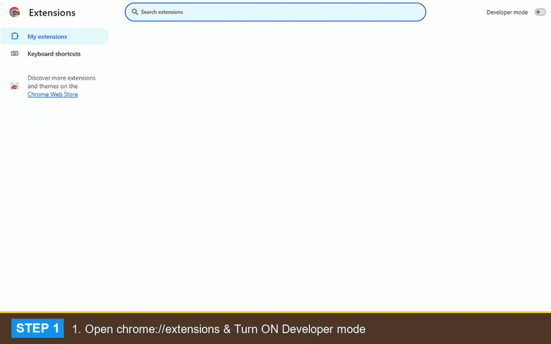

# 🛒 دیجی کالا سرچ خالص و ارگانیک (Digikala Pure Search)

### 🧹 حذف هوشمند تبلیغات، کالاهای سفارشی و شگفت انگیز از دیجی کالا
**نمایش رتبه بندی ۱۰۰٪ واقعی، ارگانیک و دست نخورده در تمام دسته بندی ها و جستجوها با چیدمان دقیق و بدون خانه خالی**

[⚡ نصب خودکار ۱-کلیک در ویندوز](#windows-install) • [🧩 نصب دستی در کروم (Load Unpacked)](#chrome-install) • [🛡️ فیلتر uBlock Origin](#ublock-filter) • [🎯 چرا این افزونه؟](#why)

---

## 🎯 مشکل چیست و این افزونه چه می کند؟

در وب سایت دیجی کالا هنگامی که کالایی را جستجو می کنید یا مرتب سازی را روی **«پرفروش ترین»**، **«ارزان ترین»** یا **«محبوب ترین»** قرار می دهید، فروشندگان با پرداخت هزینه تبلیغات (سیستم Digikala Ads)، محصولات خود را با برچسب های کم رنگی مانند **«سفارشی»** یا **«آگهی»** در بالاترین ردیف های لیست تزریق می کنند. همچنین پیشنهادهای تحمیلی شگفت انگیز و بنرهای کاروسل بین نتایج، فضای زیادی را اشغال می کنند.

این محصولات **واقعا پرفروش یا ارزان نیستند** و قرار گرفتن آن ها در صدر نتایج باعث خطای دید و خرید کالاهای نامناسب می شود.

### 🚀 شاهکار مهندسی نسخه ۲.۲ (Pre-React Network Interceptor):
اکثر مسدودسازها کالاها را در صفحه با CSS پنهان می کنند که باعث ایجاد **خانه های خالی، سفید و نامتقارن** در ردیف ها و باگ خوردن اسکرول صفحه می شود.  
افزونه **Digikala Pure Search** به صورت بنیادین در هسته مرورگر (`world: "MAIN"`) قبل از این که داده ها به ری اکت دیجی کالا برسند، درخواست های شبکه را بررسی کرده و تبلیغات را از ریشه حذف می کند:
- **چیدمان ۱۰۰٪ کامل و بدون جای خالی:** کالاها به طور پیوسته در ردیف های کامل و هم اندازه چیده می شوند.
- **اسکرول نامحدود کاملا روان (TanStack Virtualizer Immune):** هیچ گونه کرش یا باگ اسکرول در پیمایش صدها صفحه رخ نمی دهد.
- **پنل کنترلی شیشه ای مدرن:** امکان فعال یا غیرفعال سازی تفکیکی آگهی های سفارشی، شگفت انگیزها و بنرها.

---

## 📦 روش های نصب و راه اندازی (کاملا رایگان و مستقل)

### 🔹 روش اول: نصب خودکار ۱-کلیکه در ویندوز (پیشنهادی - فوق العاده ساده)

این روش بدون هیچ پیچیدگی و تنها با یک کلیک افزونه را در سیستم شما مستقر می کند:

1. آخرین نسخه منتشر شده را دانلود کنید:  
   📦 **[دانلود مستقیم پکیج رسمی افزونه (از بخش Releases)](https://github.com/omid-io/digikala-pure-search/releases/latest)**
2. فایل ZIP را از حالت فشرده خارج (Extract) کنید.
3. روی فایل **`Install.bat`** دابل کلیک کنید.
   * افزونه به صورت خودکار در سیستم شما مستقر می شود.
   * یک میانبر زیبا با عنوان **«دیجی کالا بدون تبلیغ»** روی دسکتاپ ساخته می شود.
   * با اجرای مرورگر، افزونه بلافاصله آماده به کار خواهد بود!

---

### 🔹 روش دوم: نصب دستی در مرورگر (Google Chrome و Microsoft Edge)

1. فایل ZIP پروژه را [دانلود](https://github.com/omid-io/digikala-pure-search/releases/latest) کرده و آن را از حالت فشرده خارج کنید.
2. در مرورگر کروم به آدرس `chrome://extensions` (یا در اج به `edge://extensions`) بروید.
3. در بالا سمت راست، گزینه **Developer mode (حالت توسعه دهنده)** را روشن کنید.
4. روی دکمه **Load unpacked (بارگذاری بسته باز شده)** کلیک کرده و پوشه **`extension`** را انتخاب نمایید.
5. افزونه با کنترل پنل اختصاصی فورا فعال می شود!

🎥 **[مشاهده ویدیوی ۳۰ ثانیه ای آموزش در یوتیوب](https://www.youtube.com/watch?v=osha8U8m3gM)** • **[مشاهده در آپارات](https://www.aparat.com/result/%D9%86%D8%B5%D8%A8_%D8%A7%D9%81%D8%B2%D9%88%D9%86%D9%87_%D8%AF%D8%B1_%DA%A9%D8%B1%D9%88%D9%85)**

---

### 🔹 روش سوم: استفاده به عنوان فیلتر uBlock Origin / AdGuard

اگر ترجیح می دهید از افزونه های مسدودساز عمومی استفاده کنید:
1. وارد تنظیمات uBlock شده و به زبانه **My Filters (فیلترهای من)** بروید.
2. کدهای فایل **[`ublock-filter.txt`](ublock-filter.txt)** را کپی کرده و در انتهای لیست قرار دهید.
3. دکمه **Apply changes** را بزنید.

---

## ✨ امکانات و قابلیت های کلیدی

- ⚡ **سازگار با تمام فیلترها و دسته بندی ها:** عملکرد بی نقص روی پرفروش ترین، ارزان ترین، جدیدترین، پربازدیدترین و بالاترین امتیاز.
- 🧱 **چیدمان یکپارچه بدون خانه خالی:** ردیف ها همیشه به طور دقیق و متقارن پر می مانند.
- 🛡️ **حفظ تخفیف های ارگانیک و واقعی:** کالاهایی که واقعا پرفروش هستند و تخفیف دارند حفظ می شوند و فقط تبلیغات پولی حذف می گردند.
- 🚀 **فوق العاده سبک و بدون مصرف منابع (Zero Overhead):** اجرا در سطح درخواست ای پی آی با کمترین مصرف پردازنده و رم.
- 📊 **شمارنده زنده و نشانگر وضعیت:** بج اختصاصی در گوشه صفحه با نمایش تعداد تبلیغات فیلتر شده.

---

## 👨‍💻 توسعه دهنده و سازنده

توسعه داده شده با افتخار توسط **امید ظفری (Omid Zaferi)**  
* معمار نرم افزار و سیستم های هوشمند | توسعه دهنده ابزارهای کاربردی وب و متن باز
* 🌐 وب سایت و پورتفولیو: [omid.io](https://github.com/omid-io)
* 🐙 گیت هاب: [@omid-io](https://github.com/omid-io)
* ✍️ مقاله تحلیلی در ویرگول: [پشت صحنه حذف تبلیغات دیجی کالا](https://virgool.io/@omid.zaferi/%DA%86%DA%AF%D9%88%D9%86%D9%87-%D8%AA%D8%A8%D9%84%DB%8C%D8%BA%D8%A7%D8%AA-%D9%88-%DA%A9%D8%A7%D9%84%D8%A7%D9%87%D8%A7%DB%8C-%D8%A7%D8%B3%D9%BE%D8%A7%D9%86%D8%B3%D8%B1%DB%8C-%D8%AF%DB%8C%D8%AC%DB%8C-%DA%A9%D8%A7%D9%84%D8%A7-%D8%AD%D8%B0%D9%81-%DA%A9%D9%86%DB%8C%D9%85-vxodabl4kdqm)

---

## 📄 لایسنس (License)

این پروژه تحت لایسنس **[MIT](LICENSE)** به صورت کاملا آزاد و متن باز برای جامعه توسعه دهندگان و کاربران منتشر شده است.
